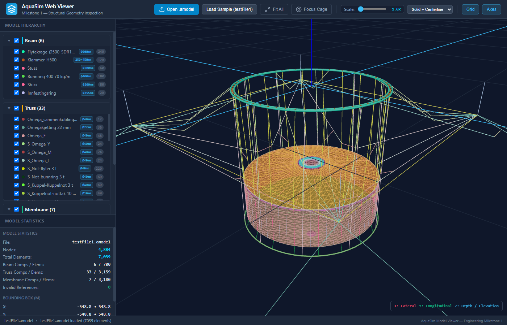
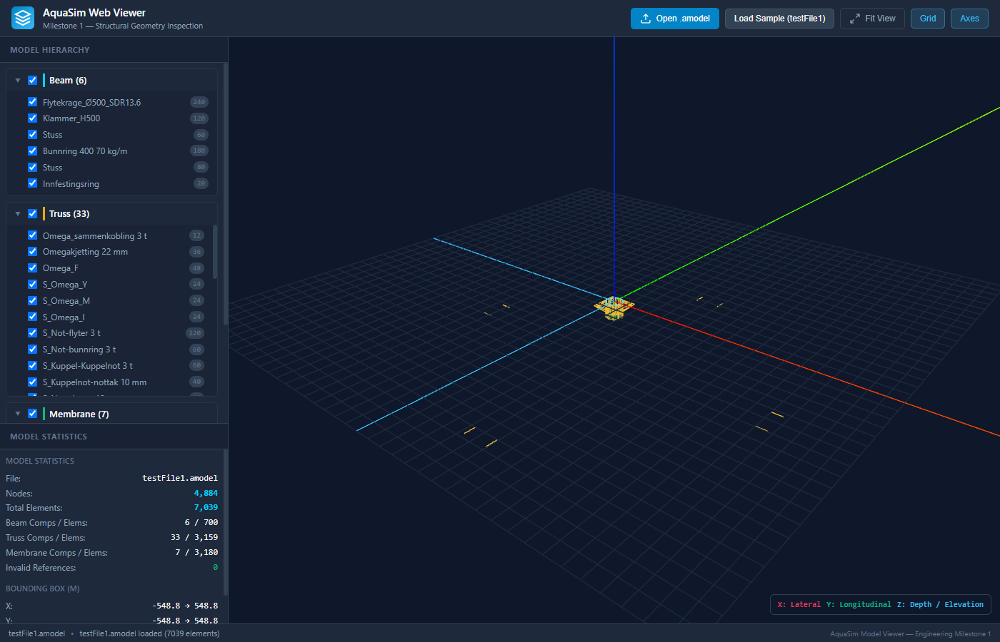

# WinchAI

A local-first winch simulation and browser-based 3D viewer for AquaSim
`.amodel` files, built with TypeScript, Three.js, Vite, and Python. The
project's target is quasi-static simulation of marine aquaculture equipment
under winch-controlled cable take-up and payout. Model files are passed only
to the loopback Python backend when **Winch Simulation** is run; they are
never sent to a remote service.

[Open the viewer](https://hui-aqua.github.io/AmodelViewer/) |
[User guide](docs/user-guide.md) | [求解器设计](docs/quasi-static-design.md) | [Project audit](docs/project-audit.md) | [MIT license](LICENSE)

## Development

Use Node.js 24 (see `.nvmrc`), then:

```sh
npm ci
npm run dev
```

Open the URL printed by Vite. Choose **Open .amodel** or drop an `.amodel`
or XML model onto the viewport. The UI supports component visibility,
model statistics, camera alignment and projection, section display modes,
grid and axes, light/dark themes, and a collapsible sidebar.
`?focus=cage` frames the cage after loading a model.
For development, start the local solver API in a second terminal with
`python -m simulation.local_server --api-only`.

## Project objective and scope

WinchAI is intended to simulate the quasi-static lifting and lowering of
offshore aquaculture structures made from pipes, beams, netting, and buoyancy
elements. The structure moves between submerged and surface conditions under
winch control. The core calculation is to find mechanical equilibrium as the
cable lengths change; simulated solver time is not required to match the
structure's real operating time.

The solver tracks structural position/orientation, cable elasticity using
source HMPE properties, and winch take-up/payout. It recomputes free-surface
buoyancy as modeled elements cross Z=0, warm-starts each state from the last
accepted equilibrium, and combines permanently connected beams into rigid
bodies. It starts from a 50 mm cable-length increment and adapts that
increment around waterline crossings, cable slack transitions, active-set
changes, and failed solves.

Each equilibrium uses sparse nonlinear solution and separate convergence
checks for force/tension, displacement, buoyancy, and constraint error. Failed
states are retried with smaller cable-length increments and are never
serialized as converged results. The Python solver generates equilibrium
states; Three.js remains a separate presentation and playback layer. Playback
speed does not alter the solved mechanical states.

## Commands

| Command | Purpose |
| --- | --- |
| `npm run dev` | Start the development server |
| `npm run winch` | Build and start the local GUI with its Python simulation API |
| `npm test` | Run parser, file loading, tree, geometry, and viewer tests |
| `npm run typecheck` | Check application and test TypeScript |
| `npm run build` | Type-check and create the production site in `dist/` |
| `npm run preview` | Serve the production build locally |
| `npm run check` | Run type checks, tests, and the production build |

## Structure

```text
src/
  main.ts                   Browser entry point
  app/initializeApp.ts      Model loading and UI orchestration
  ui/winchSimulation.ts     Simulation dialog and local API integration
  parser/                   XML parsing, validation, and model types
  viewer/
    AquaSimViewer.ts         Scene, cameras, controls, and resource lifecycle
    cameraUtils.ts          Coordinate conversion and camera framing
    renderers/              Shared line rendering, beams, trusses, membranes
  ui/                       File loading, model tree, theme and sidebar
  styles/main.css           Application styles
simulation/
  local_server.py          Loopback-only GUI server and solver API
  winch_solver.py           Quasi-static CLI
  result_format.py          AQWR v2 binary result encoding
  model_io.py               XML metadata and SI material conversion
  quasistatic/
    model.py                Model normalization and rigid assemblies
    hydrostatics.py         Free-surface clipping and pipe immersion
    equilibrium.py          Sparse force/moment equilibrium
    continuation.py         Time control and adaptive cable-length increments
tests/
  *.test.ts                 Behavior and regression tests
  fixtures/                 Model data used only by tests
tests_python/
  test_model_io.py          Input/material and optional local model regressions
  test_quasistatic.py       Mechanical equilibrium and format regressions
  test_local_server.py      Local API setting validation
scripts/run-winch.mjs       Python environment selection for local startup
models/                     Private local inputs (not static assets)
public/branding/            Runtime branding assets
docs/                       User guide and screenshots
.github/workflows/          Pages deployment and release packaging
```

The parser depends on browser XML APIs and has no Three.js dependency.
Renderers consume normalized parser types. The viewer owns rendering
resources; the application connects it to the UI. Tests use Vitest with
happy-dom and include a real model fixture without shipping it to users.

## Local winch simulation

Run the integrated local application from the repository root after installing
the Python and Node dependencies:

```sh
python -m pip install -r requirements.txt
npm ci
npm run winch
```

Open `http://127.0.0.1:8765/` and load an `.amodel`; properties load on import.
Click **Component Properties** to review or edit EA, unstretched length, mass,
and air/water weights. Edits persist for this model. Then click **Winch Simulation**.
Set each winch's **Specified payout** (positive pays out, negative hauls in,
zero holds), simulation duration, and save ΔT. Rate equals payout / duration.
Rigid beam length and EA are read-only. The adaptive internal cable increment
defaults to 50 mm; output is saved at the requested time interval, including
the initial and final equilibria. Successful results load into playback.
Each run uses a temporary local model/result;
the uploaded file is not retained by the local service. The local API accepts
loopback requests only, permits one simulation at a time, and limits playback
results to 128 MiB. Only accepted equilibrium states are emitted; the API limits results to 128 MiB.

For front-end development with Vite, run `npm run dev` and
`python -m simulation.local_server --api-only` in separate terminals. The
Vite development server proxies `/api` to the local Python service.

For direct CLI use, the default result is
`simulation_results/winch-result.aqwr`:

```sh
python -m simulation.winch_solver path/to/model.amodel \
  --payout-m 1 \
  --initial-increment-mm 50 \
  --output simulation_results/winch-result.aqwr
```

Other controls include independent convergence tolerances, nonlinear iteration
limits, `--water-density-kg-m3`, and `--no-membrane`.

Run `npm run dev`, load the matching `.amodel` with **Open .amodel**, then use
**Load result** to select an existing `.aqwr`. Playback provides a timeline,
play/pause, high-speed playback, per-element cable tension colouring, and
winch-tension/net-load plots. Model and result files remain local.

### Modeling assumptions and validation

The target's 20 upper winch endpoints are fixed at Z=0 per the stated system
boundary condition. Winch routing follows explicit source node connectivity. Implicit fairleads,
roller radius, wrap contact, and friction are not represented. Membranes are approximated as tension-only cable edges with
diagonal bracing, not shell finite elements. Review result warnings and
convergence metrics for unsupported model data.

The solver is under active development, not a certified engineering package.
Validate material properties, winch routing, rigid-body connections, loads,
and free-surface buoyancy against source-model semantics and site data before
engineering design use.

Run Python backend regressions with
`python -m unittest discover -s tests_python`; frontend checks use
`npm run check`. Private source models belong in `models/`, which is ignored for `.amodel`
files, denied by the development server and excluded from production assets. Do not publish the
private target model or generated results outside this repository without
permission.

## Build and deployment

Production output is generated only in `dist/` and is ignored by Git. The
`npm run winch` command builds this output before starting the local integrated
GUI/API; the separate GitHub Pages deployment remains a static viewer.
GitHub Pages deploys that directory through `.github/workflows/deploy.yml`.
Configure the repository's Pages source as **GitHub Actions**.
`.github/workflows/release.yml` packages the same output into
`aquasim-web-viewer-standalone.zip` when a release is published.

For offline use, unpack the release and serve its directory with a local HTTP
server (for example, `python -m http.server`). ES modules require HTTP;
opening `index.html` directly with a `file://` URL is unsupported.
The relative asset base also supports hosting under a subdirectory.
Screenshots and test fixtures are excluded from the deployed bundle.

## Screenshots

| Cage | Mooring array |
| --- | --- |
|  |  |

## Notices

AquaSim is a trademark of Aquastructure AS. This independent viewer is not
affiliated with or endorsed by Aquastructure AS. See
[third-party notices](THIRD_PARTY_NOTICES.md) for license and data notices.
